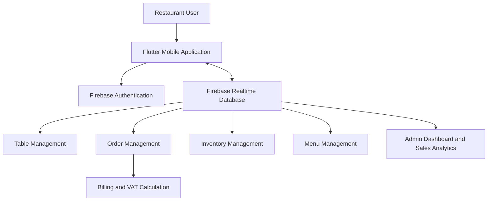

FoodieRest — Restaurant Order & Inventory Management App
A Flutter-based mobile application designed to digitize day-to-day restaurant operations. FoodieRest brings table management, order tracking, inventory monitoring, menu administration, and billing into one connected system.

  <strong>Restaurant operations, organized in one place.</strong>

  
  &nbsp;&nbsp;
  

  <em>Login and Table Management screens from the application.</em>

Overview
FoodieRest is a restaurant management mobile application built to replace disconnected, manual workflows such as paper-based orders, table-status tracking, billing, and inventory records with a centralized digital system.

The application uses Flutter for its mobile interface and Firebase for authentication and real-time data management. Its goal is to help restaurant staff manage daily operations more efficiently, keep operational information up to date, and reduce errors caused by manual processes.
Key Features
Feature	Description
Admin Dashboard	Provides an overview of restaurant activity, including sales information and analytics.
Table Management	Displays table availability and seating capacity, with Available, Reserved, and Occupied statuses.
Order Management	Supports restaurant order handling and order-status tracking.
Live Status Tracking	Keeps order-related status information updated through the connected real-time backend.
Inventory Management	Helps manage stock levels and identify items that need restocking.
Low-Stock Alerts	Highlights inventory items that fall below their configured stock threshold.
Automatic Billing	Supports bill generation with VAT calculation.
Menu Management	Organizes menu items with categories and pricing.
Authentication	Provides account sign-in using Firebase Authentication.

Application Screenshots
Login
The login screen provides an entry point for authorized users to access the application.

Table Management
The Table Management screen gives restaurant staff a visual overview of the restaurant's seating arrangement.
- Summary counters show total, available, occupied, and reserved tables.
- Status filters help staff focus on a particular table state.
- Individual table cards display table numbers and seating capacity.
- Color-coded status indicators make table availability easier to identify.

How the Application Works
FoodieRest connects its Flutter mobile interface to Firebase services.
1. Authentication: A user signs in through the login interface. Firebase Authentication handles the configured authentication flow.
2. Data access: After authentication, the application accesses the relevant restaurant data stored in Firebase Realtime Database.
3. Restaurant operations: Users work with the available modules, such as tables, orders, inventory, and menu information.
4. Real-time updates: Changes written to the realtime database can be reflected in connected application views, depending on the implemented listeners and data flow.
5. Billing: The billing functionality calculates VAT as part of the bill-generation workflow.
6. Dashboard: Administrative views present restaurant sales and operational information for monitoring.

Technology Stack
Technology	Role
Flutter	Cross-platform mobile application UI
Dart	Application programming language
Firebase Authentication	User authentication
Firebase Realtime Database	Realtime application data storage and synchronization
Git	Version control
GitHub	Source code hosting and collaboration

Project Setup
Prerequisites
Install the following tools before running the application:
- Flutter SDK (stable channel recommended)
- Dart SDK (included with Flutter)
- Android Studio or Visual Studio Code
- Android emulator or a physical Android device
- Firebase project with the services configured for the application
Verify your Flutter installation:
flutter doctor
1. Clone the Repository
Replace the repository URL below with the GitHub clone URL for this project:
git clone <YOUR_GITHUB_REPOSITORY_URL>
cd <YOUR_PROJECT_DIRECTORY>
2. Install Dependencies
flutter pub get
3. Configure Firebase
This application uses Firebase Authentication and Firebase Realtime Database.

Connect the Flutter project to the Firebase project configured for FoodieRest. If the repository uses FlutterFire CLI, configure the app with:
dart pub global activate flutterfire_cli
flutterfire configure
This normally generates or updates the Firebase options file used by the application.

Before running the app, verify that:
- The correct Android application ID is registered in Firebase.
- Firebase Authentication has the required sign-in method enabled.
- Firebase Realtime Database is created and its security rules are configured.
- The app's Firebase configuration matches the intended development or production environment.
Do not commit private credentials or unrestricted production database rules to source control.
4. Run the Application
Connect an emulator or Android device, then run:
flutter devices
flutter run
5. Build an Android APK
flutter build apk --release
The generated APK is typically available at:
build/app/outputs/flutter-apk/app-release.apk
Setup note: Firebase configuration filenames, Android application ID, package dependencies, and available run targets depend on the actual repository configuration. Follow the project's existing Firebase setup if it differs from the generic FlutterFire workflow above.

Repository Structure
The exact directory layout should reflect the source repository. A typical Flutter application is organized as follows:
foodierest/
├── android/                 # Android platform project
├── ios/                     # iOS platform project, if enabled
├── lib/
│   ├── main.dart            # Application entry point
│   ├── screens/             # Application screens
│   ├── widgets/             # Reusable UI components
│   ├── models/              # Data models
│   ├── services/            # Firebase and application services
│   └── ...                  # Other app modules
├── assets/                  # App assets
├── test/                    # Automated tests
├── pubspec.yaml             # Flutter dependencies and asset config
└── README.md
This is an illustrative Flutter structure, not a verified inventory of the repository's actual files.
Data & Security Notes
- Firebase Authentication should be used to identify authorized application users.
- Realtime Database security rules should restrict access according to the user's role and permissions.
- Production database rules should never allow unrestricted public read/write access.
- Firebase configuration and other environment-specific settings should be reviewed before release.
- VAT rates and billing rules should be configured according to the restaurant's requirements.
Project Information
Item	Details
Project	FoodieRest
Category	Restaurant Order & Inventory Management
Application Type	Flutter Mobile Application
Backend Services	Firebase Authentication and Realtime Database
Primary Use	Restaurant operations management

Screenshots & Assets
The screenshots displayed in this README are stored in:
assets/screenshots/
├── login-screen.png
└── table-management.png
Keep these image paths unchanged when uploading the README and screenshots to GitHub so that the images render correctly.

  <strong>FoodieRest</strong> 
  Digitizing restaurant operations, one workflow at a time.

